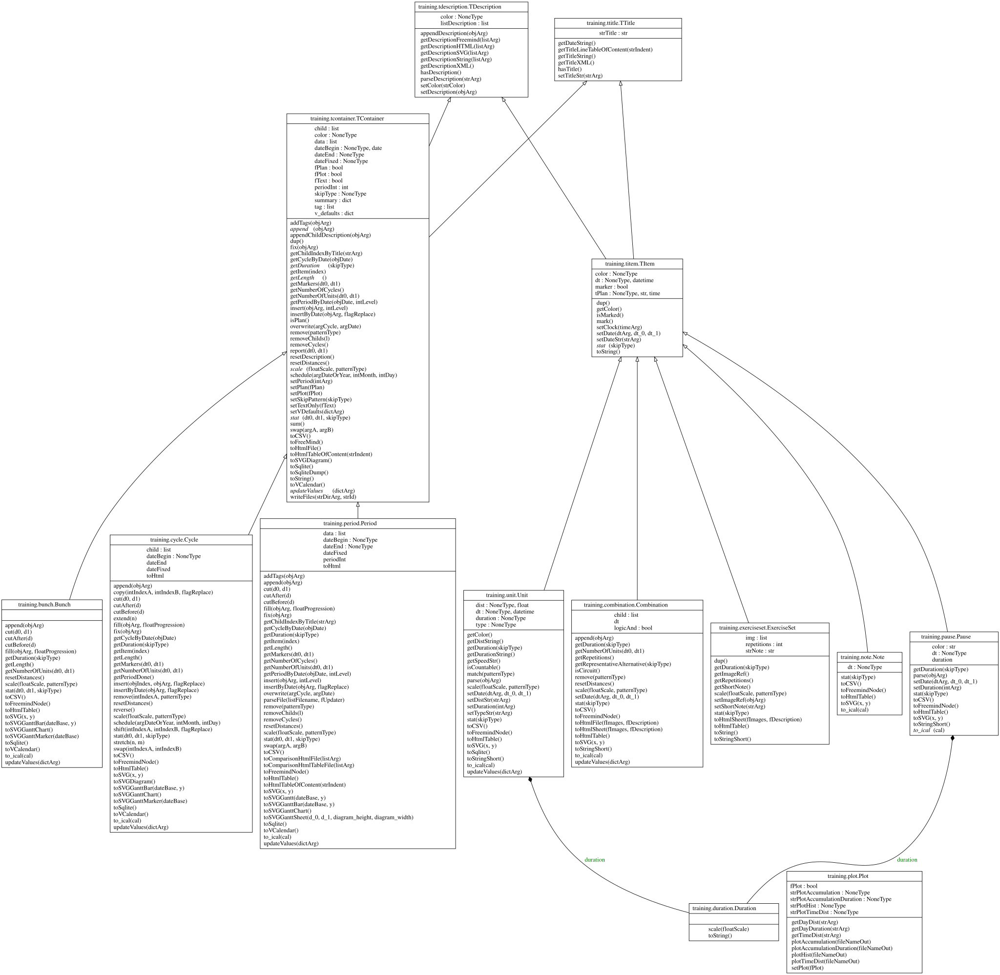
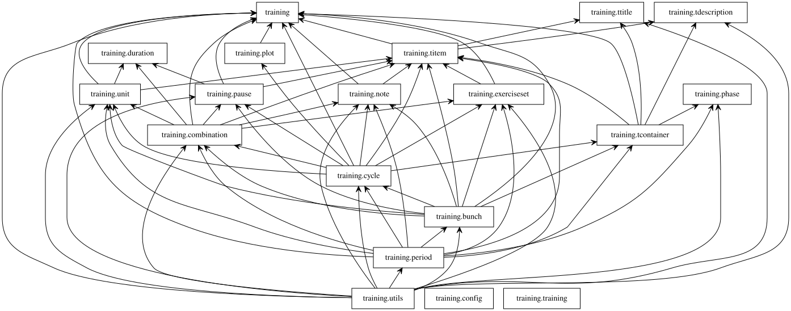

# Python module `training`

<https://pylint.pycqa.org/en/latest/additional_tools/pyreverse/index.html>

        pip3 install pylint pygraphviz
        cd docs
        pyreverse -my -A -o svg -p training ../training/*.py

## `unit`

## `cycle`

## `period`

## Plan

